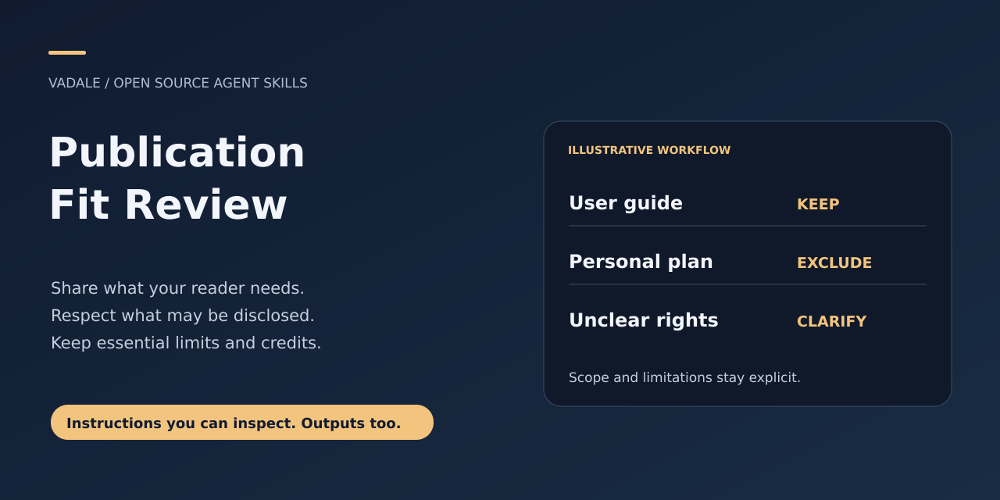
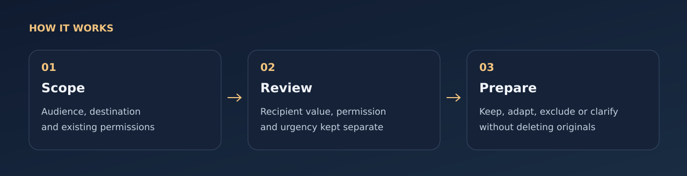

# Publication Fit Review



[MIT](LICENSE) · [Downloads](https://github.com/Vadale/publication-fit-review-skill/releases) · [Report a problem](https://github.com/Vadale/publication-fit-review-skill/issues)

Decide what belongs in a project delivery before it reaches another person.
Plan useful materials before files exist, or review an exact repository,
document, attachment or post. Separate **recipient value**, **sharing permission**
and **urgency**, then keep, adapt, exclude from the payload or clarify.

Useful for project authors who have accumulated personal notes alongside real user
documentation, and for people planning a new delivery without wanting unnecessary
documents. Same subject matter does not make personal planning useful public docs;
essential limitations and useful public tests still belong in a faithful delivery.



## Install with skills.sh or Gemini CLI

Use the cross-agent installer and select your host:

```sh
npx skills add Vadale/publication-fit-review-skill --skill publication-fit-review
```

Or install the Gemini CLI extension from its packaged release:

```sh
gemini extensions install https://github.com/Vadale/publication-fit-review-skill
```

The host must have access to the materials you explicitly select. Installation does not grant access to other projects, accounts or conversations.

Restart the assistant session and confirm the skill is visible before use.
These packaging instructions do not establish full-workflow testing in every
client, automatic model selection or a gallery ranking.

## Pi, DeepSeek Harness and Hermes

These clients can load the same complete [skills/publication-fit-review](skills/publication-fit-review)
folder. Keep its references, scripts, runtime source and licenses together;
copying only `SKILL.md` loses required resources.

**Pi:** install this repository as a Git package:

```sh
pi install git:github.com/Vadale/publication-fit-review-skill
```

**DeepSeek Harness (DSH):** from a reviewed checkout, copy the complete
`skills/publication-fit-review` folder to `.dsh/skills/publication-fit-review/`
in your target project, or to its shared `.agents/skills/publication-fit-review/`
location. Choose a new destination; do not replace an existing skill silently.
DSH needs the skill folder directly under a recognized skills root, rather than
the whole repository nested there. See the
[DSH skill guide](https://github.com/deepseek-ai/deepseek-harness/blob/master/docs/subsystems/skills.md).

**Hermes:** inspect the exact source, then install through Skills Hub:

```sh
hermes skills inspect skills-sh/Vadale/publication-fit-review-skill/publication-fit-review
hermes skills install skills-sh/Vadale/publication-fit-review-skill/publication-fit-review
```

If catalog search has not indexed the skill, the complete folder can also be
copied to a new `~/.hermes/skills/publication-fit-review/` directory
(or your configured Hermes home). See the
[Hermes skill guide](https://hermes-agent.nousresearch.com/docs/user-guide/features/skills).

Reload or restart the client and confirm that `publication-fit-review` appears.
Native catalog/body loading was checked with Pi 1.4.0, the DSH filesystem skill
provider 0.0.1-rc.3, and Hermes source revision `e3cc65d767e3`.
These checks do not establish automatic selection, marketplace ranking or a
complete model-driven workflow. The requirements and permissions below still apply.

## Try a natural request

Once this skill is installed and visible to your assistant, try:

> Before I share this repository with new users, decide which materials belong in the delivery. Personal planning stays private; keep useful setup instructions, limits and licenses.

A content map with keep, adapt, exclude or clarify decisions, separating usefulness, sharing permission and urgency. Review alone does not publish or delete anything.

See the [synthetic input/output example](examples/natural-request.md) for expected
behavior and nearby tasks that need another workflow. Automatic selection
depends on your host and model; explicit invocation remains available.

## Install in Codex

Ask the built-in installer:

```text
$skill-installer install https://github.com/Vadale/publication-fit-review-skill/tree/main/skills/publication-fit-review
```

Or copy the complete [skills/publication-fit-review](skills/publication-fit-review) folder into
`~/.agents/skills/`. Preserve its license and linked resources. Codex detects
installed skills automatically; if it does not appear, restart Codex.
[Official skill guide](https://learn.chatgpt.com/docs/build-skills).

## Use

This is a self-contained prompt skill. No runtime installation, Python package,
service, API key or companion skill is required. A file-aware assistant must be
able to inspect the materials within your authorized scope.

Use the `skills/publication-fit-review/` folder with your assistant's normal skill
loading mechanism, or give it [SKILL.md](skills/publication-fit-review/SKILL.md)
and its linked reference. If your host supports skill invocation:

> Use $publication-fit-review to review this candidate for new users of the public
> repository. Prepare a selected copy in release-staging without changing the
> originals. Retain setup, limitations, licenses and useful regression tests.
> Personal planning is private. Do not publish anything.

Before files exist:

> Use $publication-fit-review to plan the materials for this public workshop
> announcement. Here are the audience, logistics, permitted details and private
> boundaries. Produce a prioritized content map; do not create the materials yet.

For a short post, provide the exact text and audience/channel. A file inventory
is unnecessary when the literal reviewed text establishes the version.

## What you receive

A concise scope and identity header, followed by an actionable map or queue:
locator, recipient function/priority, destination-specific permission, urgency,
action, reason/evidence and necessary follow-up. If preparing adaptations is
already authorized, the assistant verifies the selected artifact and its links.
Unresolved items stay explicit without repeatedly reopening settled permissions.

See the fictional [repository review](skills/publication-fit-review/examples/repository.md)
and [planning example](skills/publication-fit-review/examples/planning.md), or
[decision reference](skills/publication-fit-review/references/decisions.md).
The examples illustrate judgment; they are not records of actual releases.

## Boundaries

Excluding from a proposed payload does not delete originals or rewrite history.
Review/adaptation authority does not automatically authorize an upload. The skill
is editorial guidance, not an enforced upload interceptor, secret scanner or
legal certification. Anonymization alone does not establish disclosure rights.
Local presence or Git tracking does not prove remote exposure. Changed content,
audience or destination can require a scoped recheck; unchanged observations may
remain useful. No blanket approval of future generated content is implied.

This product has no mandatory dependency on a project-management framework. Its
MIT terms cover these newly authored files; they grant no rights over materials
being reviewed. No human usability, market superiority or quantified savings
claim is made. Development evidence and private case answers are not distributed.

## Related workflows

[R analysis](https://github.com/Vadale/r-statistical-analysis-skill), [finding triage](https://github.com/Vadale/sec-graph-triage-skill), [personal AI-project feedback](https://github.com/Vadale/ai-project-coach-skill), [bounded action approval](https://github.com/Vadale/sentinel-action-guard-skill), [project resumption](https://github.com/Vadale/project-continuity-skill).
These are independent products; none is a required companion.
